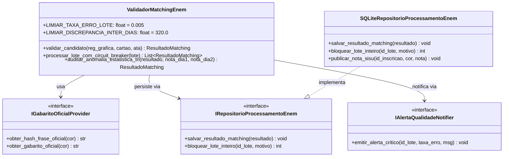

# Artefato Prático — Etapa 3 (Caso 12: Erro na Associação e Correção de Notas do ENEM 2019/2020)

Este diretório contém o artefato prático exigido na **Etapa 3** da **Avaliação 3 de Engenharia de Software II**:
> *"Modelar a rotina de validação e matching de cores vs cadernos e implementar os cenários de testes automatizados (unitários e de banco de dados) que bloqueariam processamentos inconsistentes."*

---

## 1. Arquitetura e Princípios de Projeto (SOLID)

Para corrigir o acoplamento frágil entre o arquivo de lote da gráfica (*Valid Soluções S.A.*) e o banco de dados de correção do Inep (Teoria de Resposta ao Item — TRI), a solução aplica:

- **SRP (*Single Responsibility Principle*):** A classe `ValidadorMatchingEnem` ([matching_service.py](./matching_service.py)) possui uma única responsabilidade: validar a consistência tripla (*3-Way Matching*) entre o lote gráfico, a leitura óptica do cartão-resposta e a ata de sala antes de autorizar o cálculo da nota.
- **DIP (*Dependency Inversion Principle*) e Prefira Interfaces a Classes:** O validador não depende diretamente do banco de dados SQLite nem do sistema legado da gráfica; ele depende das abstrações `IGabaritoOficialProvider`, `IRepositorioProcessamentoEnem` e `IAlertaQualidadeNotifier` definidas em [interfaces.py](./interfaces.py).
- **Defesa em Profundidade (*Defense in Depth*) no Banco de Dados:** O repositório `SQLiteRepositorioProcessamentoEnem` ([database_repository.py](./database_repository.py)) implementa *constraints* `CHECK` e a *trigger* `trg_bloqueia_nota_sem_matching`, garantindo que nem mesmo um script externo consiga publicar no SISU a nota de um candidato sem validação de cor confirmada.

### Diagrama de Classes e Componentes



---

## 2. Estrutura dos Arquivos

| Arquivo | Papel na Solução |
| :--- | :--- |
| [models.py](./models.py) | Entidades imutáveis (`@dataclass(frozen=True)`) representando `RegistroLoteGrafica`, `LeituraOpticaCartaoResposta`, `RegistroAtaSala` e `ResultadoMatching`. |
| [interfaces.py](./interfaces.py) | Contratos estáveis (`IGabaritoOficialProvider`, `IRepositorioProcessamentoEnem`, `IAlertaQualidadeNotifier`) para isolamento e uso de *Mocks*. |
| [matching_service.py](./matching_service.py) | Implementação do *3-Way Matching*, *Circuit Breaker* de lotes reimpressos (> 0,5% de erro) e *Sanity Check* estatístico da TRI inter-dias. |
| [database_repository.py](./database_repository.py) | Camada de persistência em SQLite em memória com `CHECK constraints` e `BEFORE INSERT TRIGGER` bloqueando notas inconsistentes. |
| [test_matching_enem.py](./test_matching_enem.py) | Suíte automatizada com **10 cenários de teste** (6 Testes de Unidade com `MagicMock` + 4 Testes de Integração com Banco de Dados). |

---

## 3. Cenários de Teste Implementados

### Camada 1: Testes de Unidade (com Mocks) — `TestUnitarioMatchingEnem`
1. `test_01_matching_perfeito_autoriza_calculo_tri`: Valida o caminho feliz onde lote da gráfica, marcação de cor no cartão, frase transcrita e ata indicam a mesma cor (`AZUL`).
2. `test_02_bloqueia_bug_enem_2019_troca_cor_na_grafica`: Reproduz o bug real de 2019 (lote reimpresso na gráfica vincula `AMARELO`, mas cartão e frase do aluno são `BRANCO`), bloqueando o cálculo da TRI (`pode_calcular_tri = False`).
3. `test_03_fallback_seguro_quando_aluno_esquece_bolinha_mas_transcreve_frase`: Trata o *trade-off* de erro humano do candidato (esqueceu de preencher a bolinha da cor, mas transcreveu a frase da capa `ROSA` e a ata confirma `ROSA`).
4. `test_04_rejeita_violacao_chave_primaria_entre_grafica_e_cartao`: Garante que registros com `id_inscricao` divergentes lancem exceção imediata.
5. `test_05_circuit_breaker_bloqueia_lote_quando_taxa_erro_excede_limite`: Verifica o acionamento do *Circuit Breaker* quando um lote gráfico apresenta taxa de divergência superior a 0,5%.
6. `test_06_portao_qualidade_estatistica_detecta_anomalia_tri_inter_dias`: Retém em quarentena candidatos com média alta no 1º dia/Redação ($\ge 700$) e queda abrupta no 2º dia ($\ge 320$ pontos).

### Camada 2: Testes de Integração com Banco de Dados — `TestIntegracaoBancoDadosEnem`
7. `test_07_integracao_db_permite_publicar_nota_sisu_apenas_para_matching_valido`: Persiste o *matching* válido no SQLite e publica a nota na tabela `notas_liberadas_sisu`.
8. `test_08_trigger_db_bloqueia_publicacao_de_nota_com_cor_divergente`: Comprova que a *trigger* `trg_bloqueia_nota_sem_matching` lança `sqlite3.IntegrityError` ao tentar publicar nota de candidato com divergência de cor.
9. `test_09_trigger_db_bloqueia_troca_de_cor_na_hora_de_calcular_nota`: Impede que um candidato validado como `AZUL` tenha sua nota gravada usando o gabarito `AMARELO`.
10. `test_10_quarentena_em_lote_revoga_autorizacao_de_todos_candidatos_do_lote`: Comprova que o bloqueio de lote corrompido revoga transacionalmente a autorização de todos os registros daquele lote no banco de dados.

---

## 4. Como Executar os Testes

No terminal, execute:

```bash
python3 -m unittest discover -s artefato_enem -p "test_*.py" -v
```
